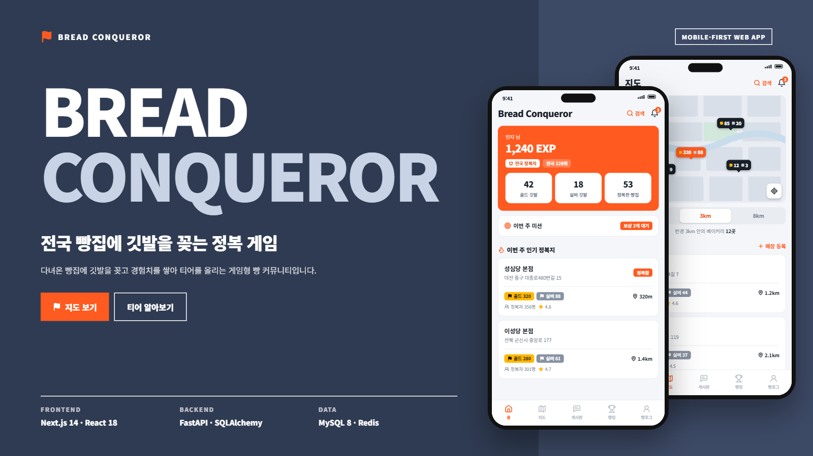
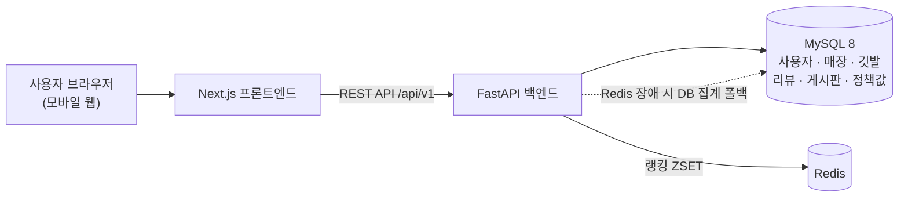
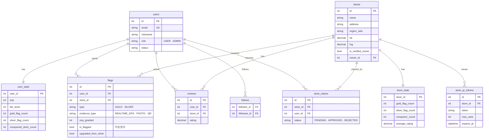
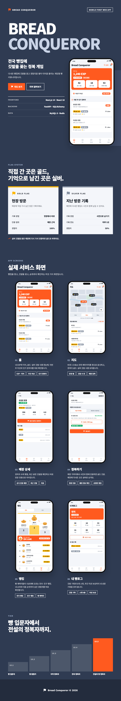

<div align="center">

# Bread Conqueror

### 다녀온 빵집에 깃발을 꽂고, 티어를 올리는 빵지순례 정복 게임



</div>

<br>

---

## 프로젝트 소개

전국 베이커리를 방문하며 **깃발(Flag)** 을 꽂고 정복하는 게임형(Gamification) 빵 커뮤니티 서비스입니다.

빵집에 직접 가서 인증하면 **골드 깃발**, 예전에 다녀온 곳을 기록하면 **실버 깃발**이 꽂힙니다. 깃발로 쌓은 경험치에 따라 **5단계 티어**가 오르고, 전국·친구 **랭킹**으로 경쟁합니다. 한 빵집에는 여러 사람의 깃발이 함께 꽂히며, 다른 사람의 깃발은 사라지지 않습니다.

<br>

---

## 개발 동기

'빵지순례'는 이미 대중적인 트렌드입니다. 설문 기준 응답자의 78.4%가 평소 빵에 관심이 있고, 81.1%는 지역 빵집을 직접 방문한 경험이 있으며, 20·30대의 30% 이상은 빵지순례를 위해 여행을 계획해 본 적이 있습니다. 인스타그램의 `#빵지순례` 인증샷 문화처럼 **방문 인증 → 기록 → 공유**라는 행동은 이미 자리 잡혀 있어, 여기에 깃발·티어·랭킹이라는 게임 규칙을 얹는 것이 자연스러운 확장이라고 판단했습니다.

다만 포스퀘어 같은 위치 기반 체크인 서비스는 "다 정복하고 나면 동기가 사라지는" 리텐션 문제를 겪었습니다. 그래서 기획 단계부터 **실버 → 골드 업그레이드**, **주간 미션**, **친구 랭킹**처럼 다시 방문할 이유를 만드는 장치를 함께 설계했습니다.

<br>

---

## 1. 개발 기간 및 작업 관리

### 개발 기간

- 전체 개발 기간 : 2026.09.09 ~ 진행 중

<br>

### 작업 관리

- GitHub로 버전을 관리하고, 로드맵 단계별로 브랜치를 나눠 PR 단위로 병합했습니다.
- Notion에 기획서 · 요구사항 명세서 · 기능 명세서 · DB 설계 · 기술 스택 명세서를 정리했습니다.
- 디자인 캔버스에서 앱 화면 쇼케이스를 먼저 만들고, 그 디자인 토큰을 프론트엔드에 그대로 옮겼습니다.

<br>

---

## 2. 개발 환경

- **Backend** : Python 3.12, FastAPI, SQLAlchemy 2.0 (async), Alembic
- **Frontend** : TypeScript, Next.js 14 (App Router), React 18
- **Database** : MySQL 8, Redis
- **배포** : Docker Compose (backend + frontend + mysql + redis)
- **버전 관리** : Github
- **협업 툴** : Notion, Github

<br>

---

## 3. 기술 스택

### 기술 선정 이유

#### FastAPI
- 깃발 하나가 생성될 때 Flag · UserStat · StoreStat · 티어가 함께 갱신되는 트랜잭션 중심 로직, GPS 반경 확인, 이동 속도 기반 이상 탐지, EXIF 사진 검증처럼 계산 로직이 많은 도메인이라 Python 생태계를 그대로 쓸 수 있는 점이 컸습니다.
- Pydantic v2로 깃발 종류 · 인증 방식 · 신고 상태 같은 다양한 ENUM 값을 타입 안전하게 검증했습니다.
- 자동 생성되는 OpenAPI 문서(`/docs`)로 별도 문서화 없이 API를 확인할 수 있습니다.

#### MySQL · SQLAlchemy 2.0 (async)
- 사용자 · 매장 · 깃발 · 리뷰 · 게시글이 외래키로 촘촘하게 연결된 관계형 도메인이라 데이터 무결성이 중요했습니다.
- Alembic으로 스키마 변경을 버전 관리하고, 테스트는 SQLite로 돌려 DB 없이도 실행되게 했습니다.

#### Redis
- 전국 · 지역 랭킹을 매 요청 DB 정렬 대신 Sorted Set(`ZADD` / `ZREVRANK`)으로 조회합니다.
- 랭킹은 best-effort로 두고 DB를 원본(Source of Truth)으로 삼아, Redis가 없어도 DB 집계로 폴백합니다.

#### Next.js · TypeScript
- 홈 · 지도 · 매장 상세 · 정복하기 · 랭킹 · 게시판 · 관리자까지 20개 가까운 화면을 App Router로 라우팅했습니다.
- 모바일 우선 웹앱으로, 설치 없이 매장 앞에서 바로 인증할 수 있게 만들었습니다.

<br>

### 기술 스택 상세

| 구분 | 기술 |
|------|------|
| Language |  Python 3.12, TypeScript 5 |
| Backend |  FastAPI, Pydantic v2, Uvicorn |
| Database | MySQL 8 (utf8mb4), SQLAlchemy 2.0 (async), aiomysql, Alembic |
| Cache / Ranking | Redis (Sorted Set) |
| Auth | JWT (PyJWT, access/refresh), passlib bcrypt, RBAC 의존성 |
| Media | exifread (EXIF 촬영 시각 · GPS 추출) |
| Frontend |  Next.js 14,  React 18, 순수 CSS (디자인 토큰) |
| Test | pytest, pytest-asyncio, aiosqlite, ruff, ESLint |
| Infra | Docker, Docker Compose |
| API Docs | Swagger / ReDoc (FastAPI 내장) |
| Collaboration |  Github, Notion |

<br>

---

## 4. ☁️ 서비스 아키텍처



<br>

---

## 5. 🗄 ERD

총 20개 테이블 중 핵심 도메인만 표시했습니다. (게시판 · 신고 · 알림 · 미션 · 정책 테이블 생략)



<br>

---

## 6. 📁 프로젝트 구조

```
bread-conqueror/
├── backend/
│   ├── alembic/                # DB 마이그레이션
│   ├── app/
│   │   ├── api/v1/routers/     # auth, users, stores, reviews, flags, rankings,
│   │   │                       # posts, social, claims, missions, notifications, admin
│   │   ├── core/               # 설정, JWT·비밀번호, 공통 Depends(인증·RBAC), Redis
│   │   ├── models/             # SQLAlchemy 모델 (20개 테이블)
│   │   ├── schemas/            # Pydantic 요청/응답 스키마
│   │   ├── services/           # 정복·티어·랭킹·이상탐지·미션·알림·매장 병합/대량등록
│   │   ├── utils/              # EXIF 파싱
│   │   └── tests/              # unit(geo·tier) + integration(정복·미션·알림 등)
│   └── scripts/seed.py         # 정책값·티어·미션·데모 계정/매장 시드
├── frontend/
│   └── src/
│       ├── app/                # 홈, 지도, 검색, 매장 상세/등록/관리, 정복, QR, 랭킹,
│       │                       # 게시판, 알림, 미션, 빵로그, 관리자
│       ├── components/         # 매장 카드, 배지, 아이콘, 빵 캐릭터, 하단 내비 등
│       └── lib/                # API 클라이언트, 인증 컨텍스트, 타입, 포맷 유틸
├── docs/images/                # README 이미지
└── docker-compose.yml          # backend + frontend + mysql + redis
```

<br>

---

## 7. 구현 내용

**정복(깃발) 시스템** `SQLAlchemy` `haversine`
- `flag_service.create_flag()` 한 번이 **하나의 트랜잭션**으로 Flag · UserStat · StoreStat · 티어를 함께 갱신 (커밋은 라우터가 소유)
- 골드 깃발 : GPS 좌표와 매장 좌표를 haversine으로 계산해 반경 `CONQUEST_RADIUS_M`(기본 50m) 이내일 때만 발급, 경험치 100%
- 실버 깃발 : 과거 방문 등록, 경험치 50%, 하루 5곳 · 누적 30곳 제한
- 실버 → 골드 업그레이드 : 실버가 꽂힌 매장을 실시간 재인증하면 승격 + 축하 연출
- 정책값(반경 · 쿨다운 · 경험치 · 제한)은 모두 `policy_configs` / `tier_policies` 테이블에서 읽어 하드코딩 없이 운영 중 조정 가능

**어뷰징 방지** `이상 탐지` `EXIF`
- 동일 (사용자, 매장) 24시간 쿨다운
- 직전 깃발과의 이동 속도가 `ABUSE_SPEED_KMH`(기본 150km/h)를 넘으면 `is_flagged=True`로 관리자 검토 큐에 올림
- 실버 인증 사진의 EXIF 촬영 시각 · GPS를 추출해 신뢰도(HIGH · MEDIUM · LOW)를 미리 보여줌
- 커뮤니티 신고 → 관리자 처리

**티어 · 랭킹** `Redis Sorted Set`
- 5단계 티어를 경험치 + **골드 비율 게이트**로 산정 (전국 정복자 이상은 골드 깃발 70% 이상 필요)
- 전국 · 지역 랭킹은 Redis ZSET, 친구 랭킹은 팔로우 관계로 집계, Redis 장애 시 DB 집계로 폴백

**매장 데이터** `하이브리드 소싱`
- 사용자 신규 매장 등록 시 반경 30m 안 기존 매장 검사로 중복 방지
- 관리자 CSV 대량 등록 : 행별 검증 · 30m 중복 스킵 · dry-run · 행별 결과 리포트
- 중복 매장 병합 : 깃발 · 리뷰 · 게시글 참조를 이관하고 집계를 재계산한 뒤 원본 폐점 처리

**사장님 기능** `Claim` `QR`
- 사업자 소유권 신청 → 관리자 승인 시 매장 소유자로 연결, "공식 인증 매장" 배지 부여
- 소유자가 정복용 QR 토큰(사용 횟수 · 만료 설정)을 발급하면, 손님은 GPS 없이 QR로 골드 인증

**리텐션 장치** `주간 미션` `인앱 알림`
- 골드 사냥꾼 · 탐험가 · 원정대 등 5종 주간 미션, 이번 주 진행도 계산과 보상 1회 수령
- 팔로우 · 댓글 · 좋아요 · Claim 심사 결과 · 티어 상승 · QR 정복 시 인앱 알림 생성

**관리자** `RBAC`
- 이상 깃발 검토 큐, 통계 대시보드, 계정 정지/해제, 경험치 · 티어 조정, 게시글 · 댓글 모더레이션, Claim 심사
- 모든 관리자 행위를 `admin_action_logs`에 기록

**프론트엔드** `디자인 토큰`
- 디자인 캔버스의 쇼케이스를 기준으로 색상 · radius · 배지 · 탭 · 버튼을 CSS 토큰으로 옮겨 화면 전체에 일관 적용
- 아이콘 라이브러리 없이 Lucide 스타일 SVG를 인라인 컴포넌트로 구성, 랭킹용 빵 캐릭터도 SVG로 직접 제작

<br>

---

## 8. ✨ 주요 기능

### 🗺️ 지도 · 매장 탐색
- 내 위치 기준 반경 1 · 3 · 8km 안의 베이커리를 핀으로 표시, 핀마다 골드 · 실버 깃발 수 표시
- 키워드 · 지역 · 종류 · 인증 매장 · 정렬 조건으로 매장 검색

### 🚩 정복하기
- **지금 여기예요** — 매장 근처에서 위치 + 사진으로 인증하면 골드 깃발
- **예전에 다녀왔어요** — 지난 방문을 사진과 함께 남기면 실버 깃발
- 실버를 꽂은 매장에 다시 가서 인증하면 골드로 업그레이드

| 구분 | 골드 깃발 | 실버 깃발 |
|---|---|---|
| 기록 방법 | 현장에서 바로 (GPS · QR) | 사진으로 남기기 |
| 인증 범위 | 매장 반경 50m | — |
| 기록 한도 | 매장당 24시간 쿨다운 | 하루 5곳 · 누적 30곳 |
| 경험치 | 100% | 50% |

### 🏆 티어 · 랭킹
| 티어 | 이름 | 필요 EXP | 골드 비율 |
|---|---|---|---|
| Lv.1 | 빵 입문자 | 0 | — |
| Lv.2 | 빵 탐험가 | 300 | — |
| Lv.3 | 지역 정복자 | 1,200 | — |
| Lv.4 | 전국 정복자 | 4,000 | 70% 이상 |
| Lv.5 | 전설의 빵 정복자 | 12,000 | 70% 이상 |

- 전국 · 친구 랭킹, 1~3위 시상대와 내 순위 · 다음 순위까지 남은 EXP 표시

### 💬 커뮤니티
- 매장 리뷰 · 별점, 추천 게시판(작성자 티어 · 깃발 수로 신뢰도 표시), 댓글 · 좋아요 · 팔로우 · 신고

### 🎯 주간 미션 · 알림
- 이번 주 미션 진행도와 보상 수령, 헤더 벨 아이콘의 읽지 않은 알림 배지

### 🏪 사장님 · 관리자
- 매장 소유권 신청과 정복용 QR 발급
- 관리자 검토 큐 · 대시보드 · 매장 병합 · CSV 대량 등록 · 계정 제재

<br>

---

## 9. 💥 트러블 슈팅

<details>
<summary><b>히어로 카드 안의 스탯 숫자가 보이지 않던 문제</b></summary>

<br>

**문제 상황**
- 홈 상단 주황색 히어로 안에 있는 골드 · 실버 · 정복한 빵집 카드의 숫자가 화면에서 사라짐

**문제 원인**
- 히어로에 지정한 흰 글자색(`color: #fff`)이 안쪽 흰 배경 카드로 그대로 상속되어, 흰 배경 위에 흰 숫자가 그려짐

**해결 과정**
- 쇼케이스 디자인의 `.st.dk` 규칙처럼 히어로 내부 카드의 글자색을 `--ink` 토큰으로 명시

```css
.hero .card {
  border-color: transparent;
  color: var(--ink);
}
```

**배운 점**
- 색을 바꾼 컨테이너 안에 다른 배경의 컴포넌트를 넣을 때는 상속되는 `color`를 컴포넌트 쪽에서 명시해야 한다는 것을 체감

</details>

<details>
<summary><b>지도 반경을 바꾸면 이전 결과가 잘못된 축척으로 그려지던 문제</b></summary>

<br>

**문제 상황**
- 반경 탭을 1km → 8km처럼 빠르게 바꾸면, 이전 반경의 매장 핀이 새 축척으로 그려져 위치가 틀어지거나 개수가 잘못 표시됨
- 핀이 지도 가장자리에 걸리면 절반이 잘려 보임

**문제 원인**
- 반경이 바뀌어도 이전 응답을 그대로 둔 채 새 요청을 보냈고, 늦게 도착한 이전 요청의 응답이 최신 결과를 덮어씀
- 가로 · 세로에 서로 다른 축척을 써서 동서 · 남북 거리가 다르게 표현됨

**해결 과정**
- 반경이 바뀌면 이전 매장 목록을 비우고, `useEffect` 정리 함수의 플래그로 늦게 도착한 응답을 무시
- 가로 · 세로에 같은 축척(`RADIUS_PX`)을 쓰고, 핀 크기를 고려한 `clamp()`로 가장자리 잘림 방지

**배운 점**
- 비동기 요청이 겹칠 수 있는 화면에서는 "가장 마지막 요청의 응답만 반영"하는 장치가 필요하다는 것을 이해

</details>

<details>
<summary><b>거리 표기가 "1000m"로 나오던 문제</b></summary>

<br>

**문제 상황**
- 999.7m 떨어진 매장이 `1000m`로 표시됨

**문제 원인**
- 단위(m / km)를 반올림 전 값으로 먼저 결정해서, 999.7은 m 단위로 분류된 뒤 1000으로 반올림됨

**해결 과정**
- 먼저 반올림한 뒤 단위를 결정하도록 순서를 바꿔 `1.0km`로 표시

```ts
const rounded = Math.round(m);
return rounded < 1000 ? `${rounded}m` : `${(m / 1000).toFixed(1)}km`;
```

**배운 점**
- 경계값 근처에서는 반올림과 분기의 순서가 결과를 바꾼다는 것을 체감

</details>

<br>

---

## 10. API 엔드포인트

- **Swagger UI:** `/docs` · **ReDoc:** `/redoc`
- **API Prefix:** `/api/v1`

| 카테고리 | 메서드 | 엔드포인트 | 설명 |
|----------|--------|------------|------|
| Auth | POST | `/auth/register` · `/auth/login` · `/auth/refresh` | 회원가입 · 로그인 · 토큰 재발급 |
| Store | GET | `/stores?lat&lng&radius_m` | 주변 베이커리 탐색 |
| Store | GET | `/stores/search` | 키워드 · 지역 · 종류 · 인증 · 정렬 검색 |
| Store | POST | `/stores` | 신규 매장 등록 (반경 30m 중복 검사) |
| Review | GET · POST | `/stores/{id}/reviews` | 리뷰 조회 · 작성 |
| Flag | POST | `/flags` | 정복 (골드 · 실버) |
| Flag | POST | `/flags/qr` | QR 정복 |
| Flag | POST | `/flags/exif-preview` | 사진 EXIF 신뢰도 미리보기 |
| Ranking | GET | `/rankings/{national,regional,friends}` | 전국 · 지역 · 친구 랭킹 |
| Post | GET · POST | `/posts` | 추천 게시판 |
| Claim | POST | `/stores/{id}/claims` | 매장 소유권 신청 |
| Claim | POST | `/stores/{id}/qr-tokens` | 정복용 QR 발급 |
| Mission | GET | `/missions/weekly` | 이번 주 미션 진행도 |
| Mission | POST | `/missions/{code}/claim` | 미션 보상 수령 |
| Notification | GET | `/notifications` · `/notifications/unread-count` | 알림 목록 · 읽지 않은 개수 |
| Admin | GET | `/admin/flags/review-queue` | 이상 깃발 검토 큐 |
| Admin | POST | `/admin/stores/{target}/merge` | 중복 매장 병합 |
| Admin | POST | `/admin/stores/bulk-upload` | CSV 대량 등록 |
| Admin | GET | `/admin/stats/dashboard` | 통계 대시보드 |

관리자 API는 `ADMIN` 권한의 JWT가 필요합니다.

<br>

---

## 11. 🚀 Getting Started

Docker가 필요합니다. (Docker 없이 실행하려면 Python 3.12, Node.js 20+, MySQL 8, Redis)

### Docker

```bash
cp backend/.env.example backend/.env      # 필요 시 값 조정
docker compose up --build
```

- 프론트 : http://localhost:3000
- API 문서 : http://localhost:8000/docs
- 컨테이너 기동 시 `alembic upgrade head` + `scripts/seed.py`가 자동 실행됩니다.
  - 정책값 · 티어 · 주간 미션 · 데모 매장
  - 데모 계정 : `admin@bread.dev / admin1234`, `demo@bread.dev / demo1234`

### Backend (Docker 없이)

```bash
docker compose up -d mysql redis

cd backend
python -m venv .venv
source .venv/bin/activate        # Windows: .venv\Scripts\activate
pip install -r requirements.txt
alembic upgrade head
python -m scripts.seed
uvicorn app.main:app --reload
```

### Frontend

```bash
cd frontend
cp .env.local.example .env.local
npm install
npm run dev
```

### Test

```bash
cd backend
ruff check .
pytest            # 단위(geo · tier) + 통합(정복 · 미션 · 알림 · Claim/QR · 병합 · 대량등록) — SQLite 사용

cd ../frontend
npm run lint
```

<br>

---

## 12. 향후 계획

- 카카오맵 SDK 연동 (현재는 위치 기반 핀 보드)
- 카카오 · 네이버 지도 검색 API로 초기 매장 데이터 자동 수집
- 인증 사진 S3 업로드 (현재는 파일명만 저장)
- 정복 완료 시 공유용 인증 카드 생성, 시즌 챌린지
- GitHub Actions CI · 클라우드 배포

<br>

---

## 13. 📱 화면 미리보기

<details>
<summary><b>쇼케이스 전체 보기 (깃발 시스템 · 앱 화면 6종 · 티어)</b></summary>

<br>

<div align="center">
  
</div>

</details>

<br>

---

<div align="center">
  <sub>Bread Conqueror · 개인 프로젝트</sub>
</div>
